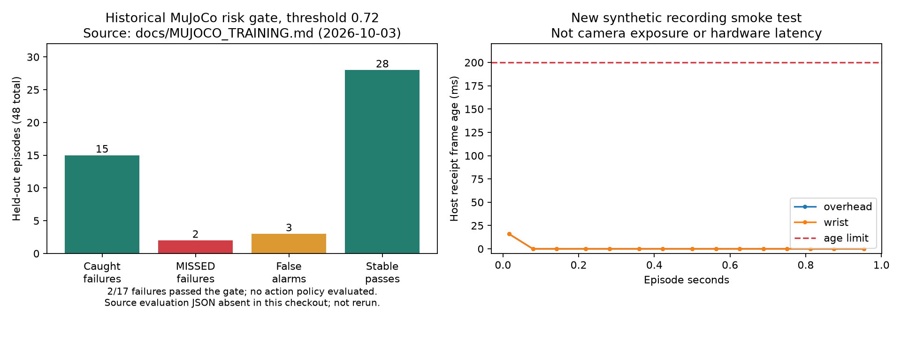

# jenga-safety-gate

**Milestone 1 (2026-10-17):** passive overhead + **moving wrist** recording,
per-camera host timestamps/sequences, integrity reports, real-teleop bridge,
event annotations and dual-view replay are implemented. See
[record/replay commands and acceptance criteria](docs/RECORDING.md).
Software/synthetic validation is separate from pending disconnected-arm checks.
The external teleop feedback/sent-command hook still needs connecting; hardware
mode never substitutes synthetic joints. Existing side-camera data stays side.



**Gate finding:** the documented MuJoCo test missed **2 of 17 failures** and
blocked **3 of 31 stable towers**. The left plot reproduces historical documented
counts, not a new evaluation (the evaluation JSON is absent in this checkout).
The right plot is the new synthetic recording test. Neither validates physical
hardware. The implemented model is a post-disturbance video risk gate; a learned
SO-101 extraction policy and wrist-view risk validation remain pending.

**Simulation training:** [MuJoCo + pretrained distilled V-JEPA setup](docs/MUJOCO_TRAINING.md)
includes the viewer, training commands, evaluation artifacts and parallel CUDA demo.

For the combined motion-aware perception and safety-gate runtime, CUDA setup,
local student training, and human-turn action checks, see
[`INTEGRATION.md`](INTEGRATION.md). The integrated runtime is dry-run only;
trained checkpoints, calibrated risk thresholds, and physical validation are
still required for autonomous Jenga.

Structural anomaly detection as a safety gate for a learned manipulation policy,
built on an SO-101 arm with VR teleoperation.

This repo is the ground-truth experiment for a broader thesis: **a learned world
model's uncertainty, not its prediction, is what should be allowed to veto an
action.** The Jenga-extraction task is a deliberately small, physically legible
domain to test that thesis end to end — collect data, train a baseline policy,
break it, detect the break, gate it, and honestly report whether gating helped.

See [`docs/PLAN.md`](docs/PLAN.md) for the full sequential build plan and
[`docs/PROGRESS.md`](docs/PROGRESS.md) for current status. Do not skip ahead —
each step in the plan produces something the next step consumes, and exit
conditions are load-bearing, not decorative.

## Repo layout

```
config/                 Hardware + experiment configuration
src/hardware/           Arm interface, camera rig control
src/perception/         Camera calibration, classical-CV tower-state extraction
src/sim/                Tower simulation + two-camera renderer (stands in for hardware)
src/rig.py              Marker layout and tower geometry, shared by sim and perception
src/data/                Episode schema, LeRobot-compatible recorder
src/policy/              ACT training + inference wrappers
src/safety/              Invariant event schema, anomaly detector, execute/block gate
src/eval/                Metrics + the Step 9 comparison table
scripts/                 One script per plan step (00-09), run in order
tests/                   Tests for the parts that don't require hardware
docs/                    PLAN.md (source of truth), PROGRESS.md (status tracker)
```

## Running order

Scripts in `scripts/` are numbered to match the plan steps exactly. `00` through `03` run end to end today on the simulation backend. `04` onward
is still being built out. Do not run a script until the previous step's exit
condition (see PLAN.md) is actually met — the pipeline is intentionally not
forgiving about this, because silent data misalignment is the most common way
projects like this quietly fail.

## Backends

The pipeline runs against either a deterministic simulation or the physical
rig, selected by `runtime.backend` in `config.yaml`. The two share every line
of code downstream of frame capture. See [`docs/SIMULATION.md`](docs/SIMULATION.md)
for what the simulation does and does not model — importantly, results
produced under `sim` are evidence that the pipeline is wired correctly, never
evidence for the thesis, and every artifact records which backend produced it.

## What's real vs. stubbed right now

Implemented and tested: the episode and Invariant event schemas, the tower
simulation, the two-camera renderer, ArUco pose recovery, tower-state
extraction (occupancy + lean), the recorder, the fail-closed gate with
threshold locking, and the metrics/comparison code.

Steps 1 and 2 are complete against the simulation backend: `20/20` on the
known-configuration validation with `720/720` slots correct and 0.23° mean
lean error. Both still need re-running on hardware.

Still pending: the physical data campaign, ACT extraction-policy training and
physical gated runs. The newer MuJoCo path implements frozen pretrained distilled
V-JEPA features, a supervised risk head and AccelSight descriptor/velocity
training. Generic cached-score distillation is also implemented. These paths
supersede older claims that all Step 6 training is stubbed; they do not establish
masked-prediction uncertainty, wrist-camera generalization or autonomous control.

## Hardware assumptions (Step 0)

| Component | Runs on |
|---|---|
| VR teleop / IK / arm control | Host PC (Quest-paired) |
| Dataset recording | Same host PC |
| Policy training (ACT) | Host PC or GPU machine |
| V-JEPA distillation | GPU machine (one-time, offline) |
| Live inference (policy + detector + gate) | Orange Pi Zero 2W |

Confirm this split in `config/config.yaml` before running anything past `01`.
